# Blood Donation and Emergency Request System — Backend

A robust, enterprise-grade, modular monolithic backend for managing blood donor registrations, clinical eligibility evaluations, blood bank inventory, emergency requests, deterministic compatibility matching, slot booking, and system auditing.

Developed with **Node.js**, **Express**, and **PostgreSQL**.

---

## 👥 Team Details

| Roll No | USN | Name | Role |
| :--- | :--- | :--- | :--- |
| **323** | **01FE24BCS159** | **Kedar Nimbalkar** | Backend & Database Design |
| **332** | **01FE24BCS168** | **Nivrutti Patil** | Architecture & Security Design |
| **333** | **01FE24BCS169** | **Sanskruti Agasgekar** | Matching & Algorithms |
| **335** | **01FE24BCS171** | **Shreya Pavaskar** | Reporting, Drives & Testing |

---

## 🏛️ Architecture & Database Design Summary

### Selected Architecture: Modular Monolithic Architecture (Alternative B)
- **Modularity**: Organizes core domain responsibilities into clear modules: `auth`, `donor`, `eligibility`, `inventory`, `compatibility`, `emergency_request`, `reservation`, `donation_drive`, and `reporting_audit`.
- **Relational Integrity**: Enforces disjoint **ISA specialization** (`users` supertype $\rightarrow$ `hospital`, `patient`, `blood_bank`, `donor` subtypes), weak-entity existence dependency (`blood_bank` $1:N$ `blood_unit` with composite primary key `(blood_bank_id, blood_unit_id)`), and $M:N$ relationships (`admits`, `donates`, `slot_bookings`).
- **ACID Guarantees**: PostgreSQL atomic transactions with row-level locks (`SELECT ... FOR UPDATE`) guarantee zero double blood-unit allocation, strict expiry checks, and prevention of donation drive overbooking.
- **Privacy Enforcement**: Donor phone numbers and sensitive medical history are stripped from responses returned to Hospital/Patient requesters.
- **Deterministic Domain Engine**: Compatibility and donor ranking use deterministic clinical rules (separate RBC and Plasma matrices; no unverified AI/ML).

```mermaid
flowchart TD
    subgraph Clients["1. Client Layer (Users & Roles)"]
        D["Donor (Web / Mobile)"]
        H["Hospital / Clinician"]
        P["Patient / Requester"]
        B["Blood Bank Staff"]
        A["System Administrator"]
    end

    subgraph APILayer["2. API & Security Layer (Express Gateway)"]
        GW["Express Router & HTTP Server"]
        AUTH_MW["JWT Authentication Middleware"]
        RBAC_MW["ISA Role Authorization Guard"]
        PRIVACY_MW["Donor Privacy Filter (Hides Phone/Medical Notes)"]
        VAL_MW["Input Validation & Joi Schemas"]
        ERR_MW["Centralized Error Handler (AppError & DB Codes)"]
    end

    subgraph Modules["3. Modular Monolithic Business Services"]
        AUTH_MOD["auth_module<br/>(FR-01: Login, Registration & ISA Subtypes)"]
        DONOR_MOD["donor_module<br/>(FR-02: Profile, Availability & History)"]
        ELIG_MOD["eligibility_module<br/>(FR-03: Age, Weight, Interval & Deferrals)"]
        INV_MOD["inventory_module<br/>(FR-04, FR-05: Weak-Entity Tracking, Expiry & Transfers)"]
        COMPAT_MOD["compatibility_module<br/>(FR-07: Deterministic RBC & Plasma Matrices)"]
        REQ_MOD["emergency_request_module<br/>(FR-06, FR-08, FR-09: Requests, Multi-Factor Ranking & Escalation)"]
        RES_MOD["reservation_module<br/>(FR-10: Part-B Atomic Transaction & Row-Locking Fulfillment)"]
        DRIVE_MOD["donation_drive_module<br/>(FR-11: Drives, Slot Booking & Overbooking Lock)"]
        REP_MOD["reporting_audit_module<br/>(FR-12: Dashboard KPIs, CSV Export & Audit Trail)"]
    end

    subgraph DataAccess["4. Data Access & Transaction Coordinator"]
        POOL["PostgreSQL Connection Pool (pg.Pool / pg-mem fallback)"]
        TX["Transaction Coordinator (BEGIN / FOR UPDATE / COMMIT / ROLLBACK)"]
    end

    subgraph Database["5. PostgreSQL Relational Store (ACID)"]
        USERS_TB["users (Supertype)"]
        ISA_TB["ISA Subtypes: hospital | patient | blood_bank | donor"]
        UNIT_TB["blood_unit (Weak Entity composite PK)"]
        REQ_TB["blood_request & reservations"]
        REL_TB["admits | donates | donation_drives | slot_bookings"]
        AUDIT_TB["audit_logs (Immutable) & system_rules"]
    end

    subgraph Storage["6. File / Object Storage"]
        CSV_STORE["CSV Reports & Artifacts (/storage)"]
    end

    %% Client to API
    D & H & P & B & A --> GW
    GW --> AUTH_MW --> RBAC_MW --> PRIVACY_MW --> VAL_MW

    %% API to Modules
    VAL_MW --> AUTH_MOD & DONOR_MOD & ELIG_MOD & INV_MOD & COMPAT_MOD & REQ_MOD & RES_MOD & DRIVE_MOD & REP_MOD

    %% Inter-module workflows
    REQ_MOD -->|Validate Match| COMPAT_MOD
    REQ_MOD -->|Check Eligibility| ELIG_MOD
    RES_MOD -->|Compatibility Check| COMPAT_MOD
    DRIVE_MOD -->|Eligibility Check| ELIG_MOD
    REP_MOD -->|Export CSV| CSV_STORE

    %% Modules to Data Access
    AUTH_MOD & DONOR_MOD & ELIG_MOD & INV_MOD & REQ_MOD & DRIVE_MOD --> POOL
    RES_MOD & INV_MOD --> TX --> POOL

    %% Pool to DB Tables
    POOL --> USERS_TB & ISA_TB & UNIT_TB & REQ_TB & REL_TB & AUDIT_TB
    ERR_MW -.->|Catches Exceptions| GW
```



---

## 📋 Functional Requirements Implementation (FR-01 to FR-12)

| Requirement | Implementation Function | Endpoint / Service | Description |
| :--- | :--- | :--- | :--- |
| **FR-01** | `authenticate_user()` | `POST /api/auth/login` | Role-based JWT authentication with bcrypt password verification and audit logging. |
| **FR-02** | `manage_donor()` | `GET/PUT /api/donors/:donor_id` | Donor profile management, availability updates, and privacy-protected access. |
| **FR-03** | `calculate_eligibility()` | `GET /api/eligibility/:donor_id` | Deterministic eligibility check (age 18–65, weight $\ge$ 50kg, 90-day donation interval, deferral dates). |
| **FR-04** | `track_blood_unit()` | `POST /api/inventory/:blood_bank_id/units` | Weak-entity unit tracking, positive quantity enforcement, and collection $\le$ expiry date validation. |
| **FR-05** | `check_inventory_status()` | `GET /api/inventory/:blood_bank_id/units/:unit_id` | Expiry status, usable quantity verification, and low-stock/critical threshold alerts. |
| **FR-06** | `create_blood_request()` | `POST /api/requests` | Emergency request creation with urgency (`NORMAL`, `URGENT`, `CRITICAL`) and required-by timestamps. |
| **FR-07** | `check_compatibility()` | `POST /api/compatibility/check` | Separate deterministic matrices for RBC/Whole Blood ($O^-$ universal donor) and Plasma ($AB$ universal donor). |
| **FR-08** | `rank_eligible_donors()` | `GET /api/requests/:request_id/donors` | Ranks eligible donors by blood match (40%), location (30%), donation interval (15%), and response history (15%). |
| **FR-09** | `update_request_status()` | `PATCH /api/requests/:request_id/status` | Lifecycle management (`PENDING`, `MATCHED`, `RESERVED`, `PARTIALLY_FULFILLED`, `FULFILLED`, `ESCALATED`). |
| **FR-10** | `reserve_blood_unit()` | `POST /api/reservations/fulfill` | Atomic row-locking fulfillment algorithm (`SELECT ... FOR UPDATE`) with complete rollback on conflict. |
| **FR-11** | `book_donation_slot()` | `POST /api/drives/book` | Drive slot booking with capacity lock, duplicate prevention, and donor eligibility verification. |
| **FR-12** | `generate_system_report()`| `GET /api/reports/:report_type` | Dashboard KPIs, inventory status, audit trail, and downloadable CSV exports. |

---

## 🩸 Compatibility Matrices

### 1. Red Blood Cells (RBC) & Whole Blood
Universal Donor: **O-** | Universal Recipient: **AB+**
- **O-**: Receives from `O-`
- **O+**: Receives from `O-`, `O+`
- **A-**: Receives from `O-`, `A-`
- **A+**: Receives from `O-`, `O+`, `A-`, `A+`
- **B-**: Receives from `O-`, `B-`
- **B+**: Receives from `O-`, `O+`, `B-`, `B+`
- **AB-**: Receives from `O-`, `A-`, `B-`, `AB-`
- **AB+**: Receives from `O-`, `O+`, `A-`, `A+`, `B-`, `B+`, `AB-`, `AB+`

### 2. Plasma
Universal Donor: **AB** | Universal Recipient: **O**
- **O- / O+**: Receives from `O-`, `O+`, `A-`, `A+`, `B-`, `B+`, `AB-`, `AB+`
- **A- / A+**: Receives from `A-`, `A+`, `AB-`, `AB+`
- **B- / B+**: Receives from `B-`, `B+`, `AB-`, `AB+`
- **AB- / AB+**: Receives from `AB-`, `AB+`

---

## 🔒 Part-B Algorithm: `reserveAndFulfillBloodRequest`

The reservation and fulfillment algorithm is executed inside a single PostgreSQL atomic transaction:
```sql
BEGIN;
-- 1. Lock blood request row
SELECT * FROM blood_request WHERE req_id = $1 FOR UPDATE;

-- 2. Lock weak-entity blood unit row
SELECT * FROM blood_unit WHERE blood_bank_id = $2 AND blood_unit_id = $3 FOR UPDATE;

-- 3. Verify:
--    a. staffUser.role === 'BLOOD_BANK_STAFF'
--    b. request.status !== 'FULFILLED'
--    c. blood_unit.expiry_date > CURRENT_DATE (no expired blood)
--    d. checkCompatibility(unit.blood_group, request.blood_group, request.component) === true
--    e. blood_unit.quantity >= requestedQty

-- 4. Deduct quantity & update request status
UPDATE blood_unit SET quantity = quantity - $requestedQty ...;
UPDATE blood_request SET status = 'FULFILLED', fulfilled_quantity = ...;

-- 5. Insert reservation and immutable audit log entry
INSERT INTO reservations ...;
INSERT INTO audit_logs ...;

COMMIT; -- Or ROLLBACK on any failure
```

---

## 🚀 Getting Started

### Prerequisites
- Node.js (v18+)
- PostgreSQL 14+ (Optional: if PostgreSQL daemon is not running, the application automatically activates its embedded `pg-mem` in-memory PostgreSQL engine for zero-setup execution).

### Installation
```bash
# Clone the repository and install dependencies
npm install
```

### Environment Configuration
Copy `.env.example` to `.env`:
```bash
cp .env.example .env
```

### Database Setup & Seeding
```bash
# Run database schema migrations and seed realistic test data
npm run seed
```

### Running the Server
```bash
# Start server (default on port 5000)
npm start
```
The server will initialize at: `http://localhost:5000`
- Health check: `http://localhost:5000/health`
- Team info: `http://localhost:5000/api/team`

### Pre-seeded Test Accounts
All pre-seeded test accounts use the password: `Password123!`

| Role | Email |
| :--- | :--- |
| **ADMIN** | `admin@bloodconnect.org` |
| **BLOOD_BANK_STAFF** | `staff.central@bloodconnect.org` |
| **HOSPITAL** | `emergency@cityhospital.org` |
| **PATIENT** | `patient.rahul@gmail.com` |
| **DONOR** | `donor.arun@gmail.com` (Universal O- Donor) |

---

## 🧪 Running Automated Tests

Run the complete Jest test suite covering all 12 functional requirements, boundary tests, edge cases, and concurrency simulations:
```bash
npm test
```
Result: **51 tests passing across 9 test suites** (100% pass rate).

---

## 📁 Project Structure

```
d:\AI-SE\AIASD_Project\
├── package.json
├── .env.example
├── .env
├── README.md
├── src/
│   ├── app.js                          # Express application configuration
│   ├── server.js                       # Server startup & graceful shutdown
│   ├── config/
│   │   ├── env.js                      # Environment variables
│   │   ├── database.js                 # PostgreSQL Pool & pg-mem auto-fallback
│   │   └── rules.js                    # Deterministic domain rules & matrices
│   ├── middleware/
│   │   ├── auth.js                     # JWT auth & donor privacy sanitization
│   │   ├── errorHandler.js             # Standardized JSON error response handler
│   │   └── validator.js                # Joi request schema validation
│   ├── models/
│   │   ├── schema.sql                  # PostgreSQL DDL (ISA subtypes & weak entities)
│   │   ├── seed.sql                    # Initial seed data
│   │   └── runSeed.js                  # Standalone migration script
│   ├── utils/
│   │   ├── logger.js                   # Structured logging
│   │   └── csvExporter.js              # CSV conversion and file storage
│   └── modules/
│       ├── auth/                       # FR-01: Authentication & ISA Subtypes
│       ├── donor/                      # FR-02: Donor Profile & Privacy
│       ├── eligibility/                # FR-03: Deterministic Eligibility Engine
│       ├── inventory/                  # FR-04 & FR-05: Inventory & Expiry
│       ├── compatibility/              # FR-07: RBC & Plasma Compatibility Matrices
│       ├── emergency_request/          # FR-06, FR-08, FR-09: Requests, Ranking, Escalation
│       ├── reservation/                # FR-10: Part-B Atomic Allocation Algorithm
│       ├── donation_drive/             # FR-11: Drives & Slot Booking
│       └── reporting_audit/            # FR-12: Dashboard KPIs, Auditing & CSV
└── tests/
    ├── testHelper.js                   # Test database setup & token generator
    ├── auth.test.js                    # FR-01 test suite
    ├── donor.test.js                   # FR-02 test suite
    ├── eligibility.test.js             # FR-03 test suite
    ├── inventory.test.js               # FR-04 & FR-05 test suite
    ├── compatibility.test.js           # FR-07 test suite
    ├── matching.test.js                # FR-08 test suite
    ├── reservations.test.js            # FR-10 test suite
    ├── drives.test.js                  # FR-11 test suite
    ├── reports.test.js                 # FR-12 test suite
    └── api.test.js                     # End-to-end integration test suite
```
